# Live check report

Run: Mon 16 Nov 2026, 09:50 (Melbourne, AEDT)

**Result: no problems found.**


## Ballan Services

<details open><summary>Wide, light</summary>

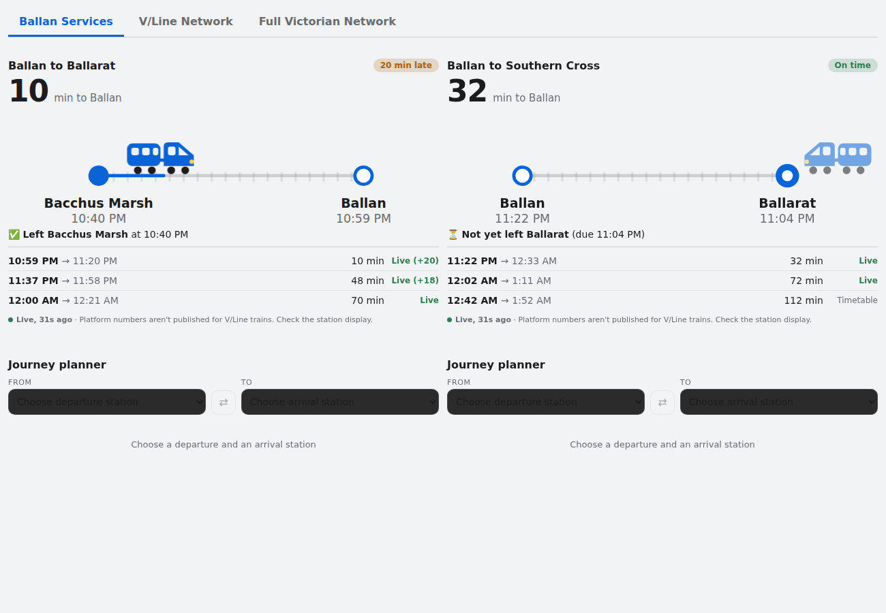

</details>

<details><summary>Wide, dark</summary>

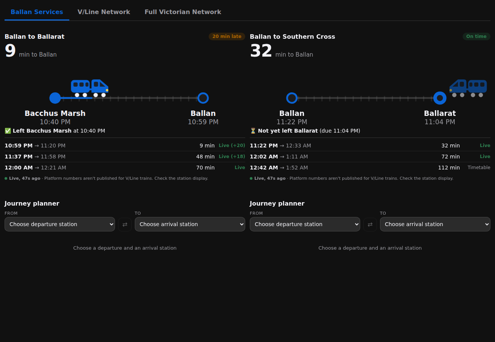

</details>

<details><summary>Phone, light</summary>

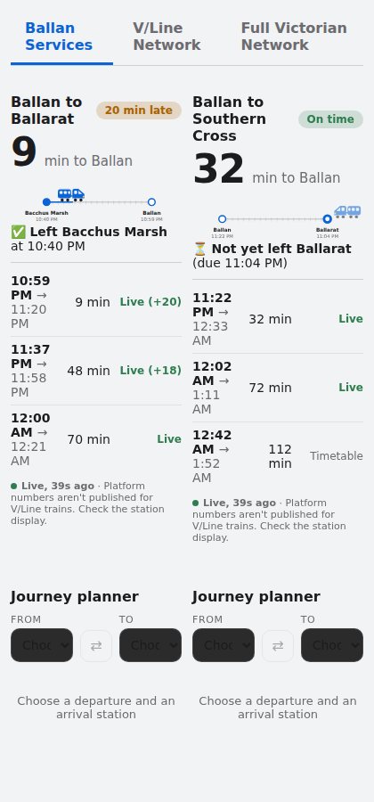

</details>

<details><summary>Phone, dark</summary>

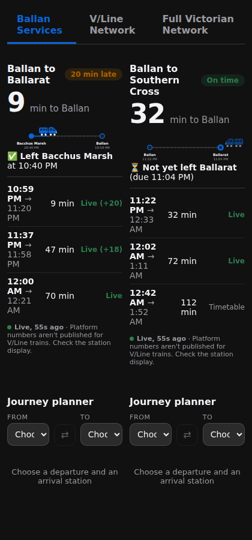

</details>


## V/Line Network (geographic map)

<details open><summary>Wide, light</summary>

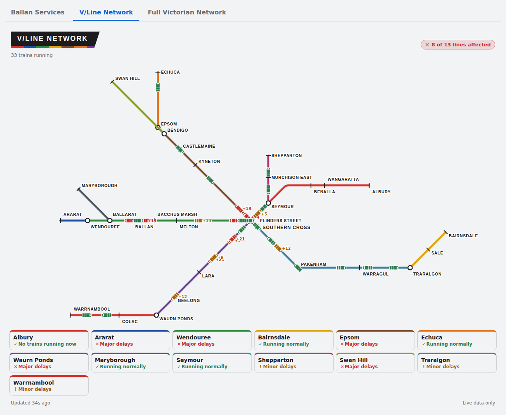

</details>

<details><summary>Wide, dark</summary>

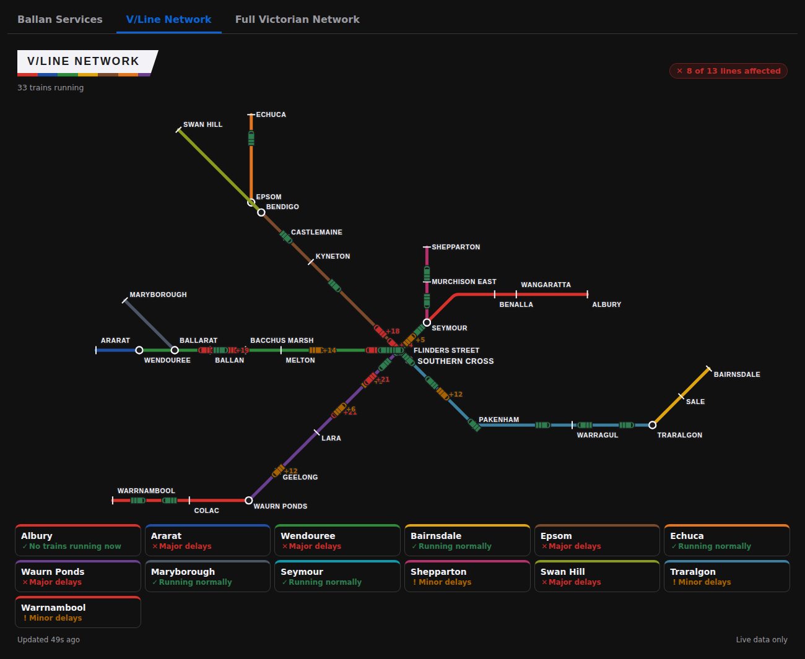

</details>

<details><summary>Phone, light</summary>

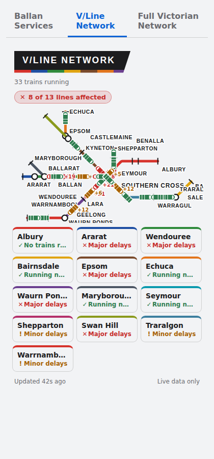

</details>

<details><summary>Phone, dark</summary>

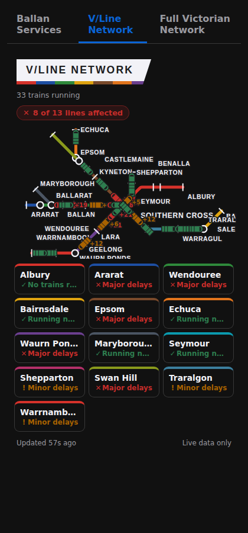

</details>


## Full Victorian Network (official map)

<details open><summary>Wide, light</summary>

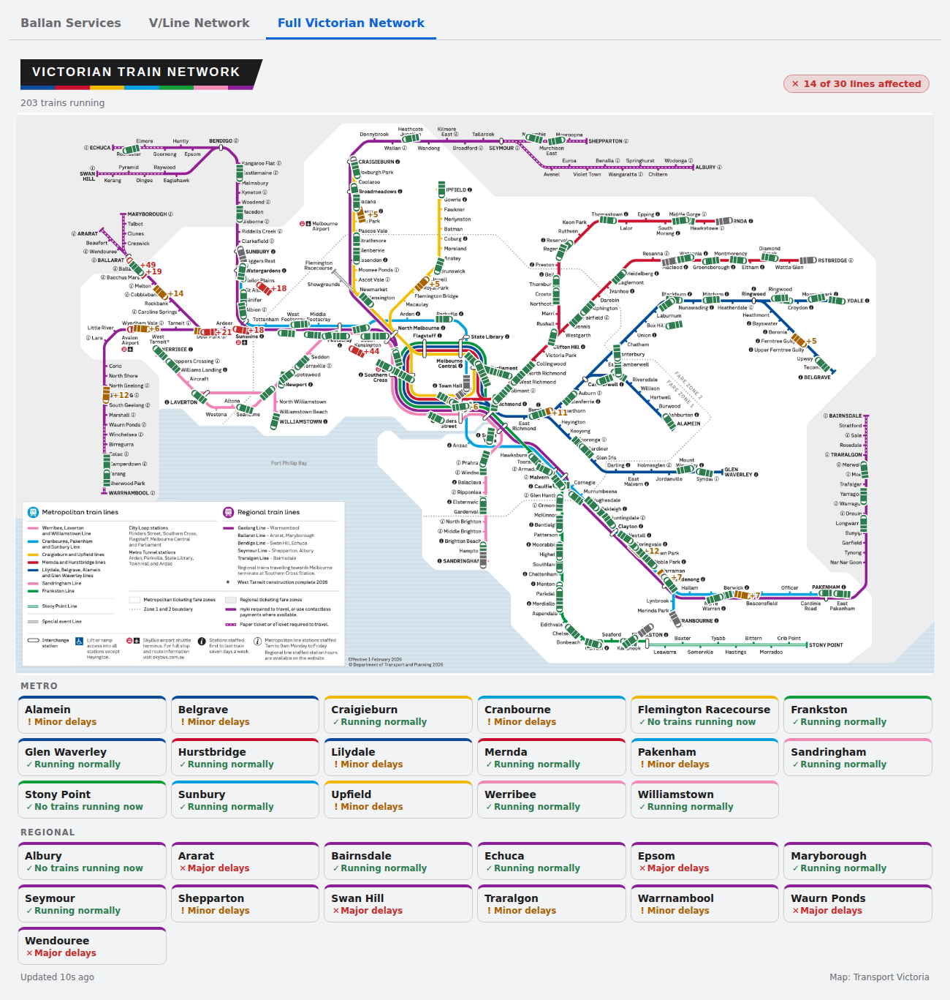

</details>

<details><summary>Wide, dark</summary>

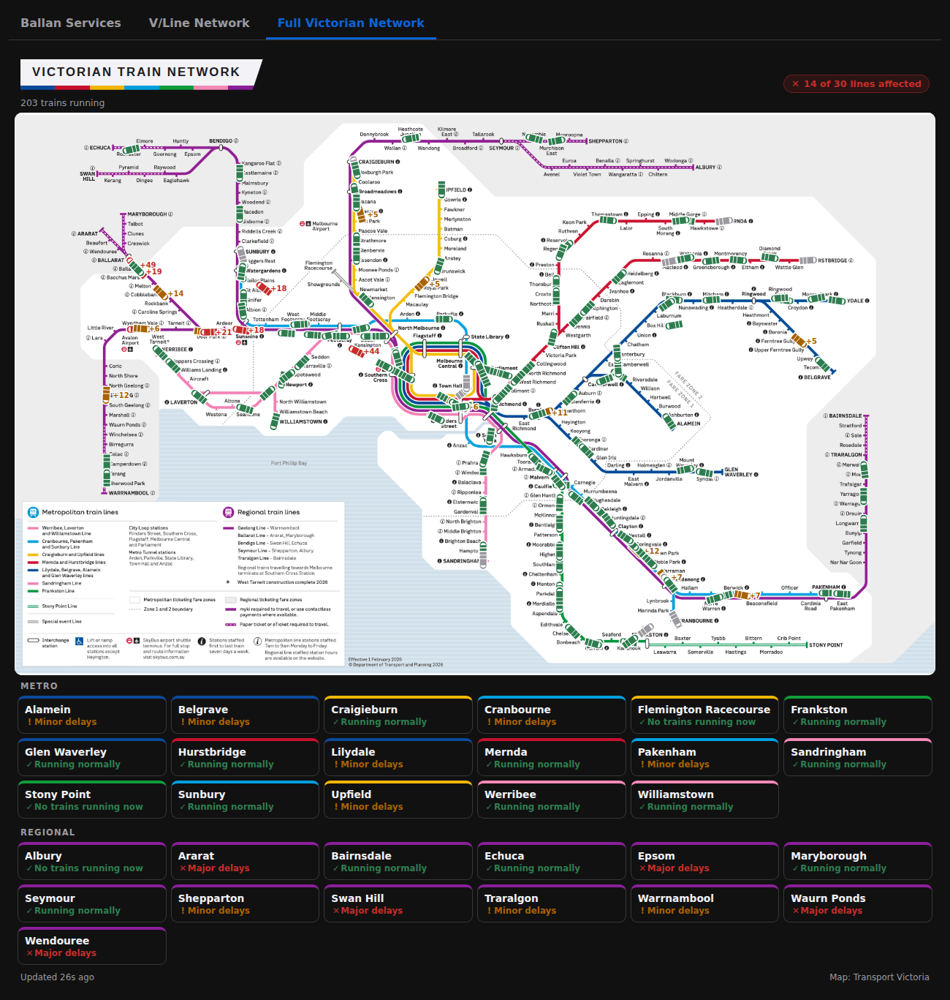

</details>

<details><summary>Phone, light</summary>

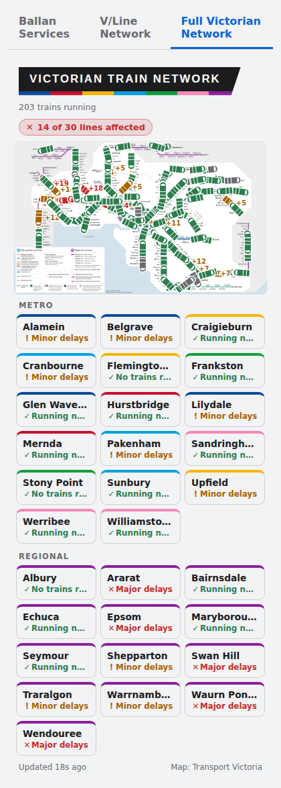

</details>

<details><summary>Phone, dark</summary>

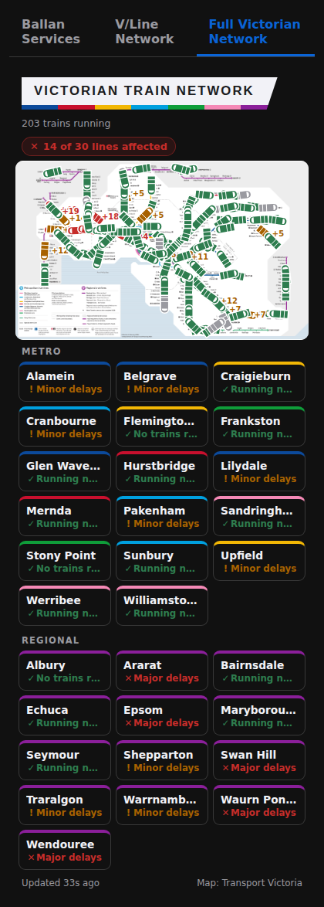

</details>


## Live check log

```

== Key check ==
  length 36, UUID-shaped
  header KeyId: HTTP 200, 10657 bytes
  header Ocp-Apim-Subscription-Key: HTTP 401, 660 bytes, body: '<?xml version="1.0" encoding="UTF-8"?>\n<env:Envelope xmlns:env="http://www.w3.org/2003/05/soap-envelope">\n   <env:Header>\n   </env:Header>\n   <env:Body>\n      <'

== Regional (V/Line) ==
  log   No ptv_devid/ptv_key set: network map uses live data only
  log   Checking for a newer timetable...
  log   Downloaded new timetable (58010 KB regional feed)
  log   Network map ready: 13 lines, 13493 trips
  log   Journey planner timetable ready: 110 stations, 1436 trips
  log   Timetable ready: 2243 candidate trips
  log   Feed: 62 trip updates, 33 vehicles, 10 trip IDs match the timetable (realtime stale=False, vehicles stale=False)
  log   Match check: 62 of 62 trip updates and 33 of 33 vehicles match the whole-network timetable (0 trip IDs matched by route + train number) (13493 trips)
  log   Card diag 01-MBY--6-T0-8172: start_date=20261116 cancelled=False updates=1 first=[(16, '20043')] | timetable calls={'ballan_to_southern_cross': (6, '20292', 16, '20043')} ballan seq/stop=6/20292 | vehicle=yes
  log   Card diag 01-ART--6-T0-8181: start_date=20261116 cancelled=False updates=1 first=[(11, '20292')] | timetable calls={'ballan_to_ballarat': (11, '20292', 12, '20293')} ballan seq/stop=11/20292 | vehicle=yes
  log   Card diag 01-BAT--6-T0-8111: start_date=20261116 cancelled=False updates=2 first=[(10, '20290'), (11, '20292')] | timetable calls={'ballan_to_ballarat': (11, '20292', 12, '20293')} ballan seq/stop=11/20292 | vehicle=yes
  log   Card diag next ballan_to_ballarat: 01-BAT--6-T0-8111 status=live in_live=True live ids with same number: ['01-BAT--6-T0-8111', '01-BAT--6-T0-8111']
  log   Card diag next ballan_to_ballarat: 01-BAT--6-T0-8113 status=live in_live=True live ids with same number: ['01-BAT--6-T0-8113', '01-BAT--6-T0-8113']
  log   Card diag next ballan_to_southern_cross: 01-BAT--6-T0-8124 status=live in_live=True live ids with same number: ['01-BAT--6-T0-8124']
  log   Card diag next ballan_to_southern_cross: 01-BAT--6-T0-8126 status=live in_live=True live ids with same number: ['01-BAT--6-T0-8126']
  feed: ['Feed: 62 trip updates, 33 vehicles, 10 trip IDs match the timetable (realtime stale=False, vehicles stale=False)']

== Metro ==
  log   Downloaded metro timetable (24876 KB)
  log   Metro network ready: 17 lines, 40829 trips
  log   Metro feed: 249 trip updates (234 in timetable), 170 vehicles, 170 drawn

== Map coverage (stations found on the official map) ==
  Metro    Alamein                   17/17 
  Metro    Belgrave                  26/27 
  Metro    Cranbourne                19/19 
  Metro    Craigieburn               18/18 
  Metro    Frankston                 31/32 
  Metro    Glen Waverley             20/20 
  Metro    Hurstbridge               27/28 
  Metro    Lilydale                  22/23 
  Metro    Mernda                    28/29 
  Metro    Pakenham                  24/24 
  Metro    Flemington Racecourse      4/4  
  Metro    Sandringham               14/14 
  Metro    Stony Point               10/10 
  Metro    Sunbury                   16/16 
  Metro    Upfield                   16/16 
  Metro    Werribee                  17/17 
  Metro    Williamstown              12/12 
  Regional Albury                    12/12 
  Regional Ararat                    15/15 
  Regional Wendouree                 13/13 
  Regional Bairnsdale                23/23 
  Regional Epsom                     13/14 
  Regional Echuca                    18/19 
  Regional Waurn Ponds               16/16 
  Regional Maryborough               16/16 
  Regional Seymour                   12/12 
  Regional Shepparton                16/16 
  Regional Swan Hill                 16/16 
  Regional Traralgon                 20/20 
  Regional Warrnambool               21/21 

== Sensors ==
  sensor.vline_network: state=33 vehicles=33 worst=major diag=
  sensor.vline_ballan_to_ballarat: state=2026-11-16T09:59:30+11:00 vehicles=0 worst=None diag=
  sensor.vline_ballan_to_ballarat_train: state=tracking vehicles=0 worst=None diag=
  sensor.vline_ballan_to_southern_cross: state=2026-11-16T10:22:00+11:00 vehicles=0 worst=None diag=
  sensor.vline_ballan_to_southern_cross_train: state=no live train vehicles=0 worst=None diag=
  sensor.metro_network: state=170 vehicles=170 worst=minor diag=249 trip updates (234 in timetable), 170 vehicles, 170 drawn

Warnings:
  none
Problems:
  none

```
